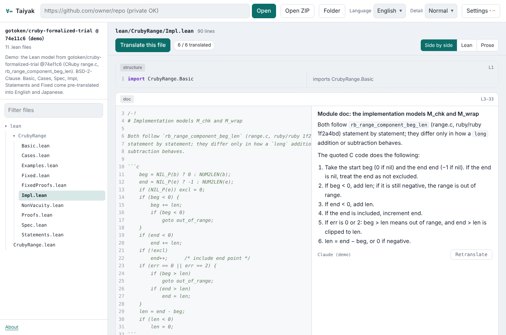

# Taiyak

[English](../README.md) · [日本語](README.ja.md) · **简体中文** · [繁體中文](README.zh-Hant.md) · [한국어](README.ko.md) · [Français](README.fr.md) · [Deutsch](README.de.md) · [Español](README.es.md) · [Português](README.pt.md) · [Русский](README.ru.md)

一个浏览器：把 Lean 4 源代码按声明切分，并在每个声明旁边显示用你所选自然语言写成的数学译文。它只读取源代码，不需要构建 Lean。名称取自日语“対訳”（taiyaku，原文与译文对照）。

**网页版：<https://taiyak.pages.dev/>**



## 功能

- 从 GitHub URL（也支持私有仓库）、ZIP 文件或文件夹打开 Lean 4 仓库
- 按声明（`def`、`theorem`、`structure` 等）逐个并排显示 Lean 代码和译文。可译成日语、英语、中文（简体或繁体）、韩语、法语、德语、西班牙语、葡萄牙语或俄语，也可以输入其他任何语言
- 只需选择一种语言，译文、界面、术语说明和“询问 Claude”的解释都会使用该语言。界面文字内置上述十种语言（其他语言显示英语）。术语说明内置日语和英语；其他语言在第一次选择时由 Claude 翻译并保存在浏览器中（先翻译你点击的词，其余在后台继续翻译并显示进度）。也可以在设置中单独固定界面语言
- 首次打开时，如果浏览器的首选语言中日语排在英语之前，就以日语显示，否则以英语显示
- 翻译时，会把当前文件引用的、在 import 的文件中定义的内容作为上下文一并发送
- 点击标识符可查看其定义摘要并跳转到定义处。`∀`、`omega`、`rcases` 等符号和策略（tactic）会显示简短说明
- 较长的证明默认折叠
- 译文保存在浏览器中。导出后提交到仓库，打开该仓库的人无需 API 密钥即可阅读译文
- 可以生成直接打开某个文件或声明的分享链接

## 使用方法

### 网页版（Cloudflare Pages）

打开 <https://taiyak.pages.dev/>。

1. 输入 GitHub URL，点击“打开”
2. 在“设置”中填入 Anthropic API 密钥（翻译需要）。如果是私有仓库，还要填入 GitHub 令牌。点击设置中的“在 GitHub 上创建令牌”，会打开 GitHub 的令牌创建页面，并已填好只读权限（Contents: read）和 30 天有效期：只需选择要读取的仓库并创建
3. 点击“翻译此文件”，或单个代码块上的“翻译”

不输入 URL 直接打开时，会显示一个演示：CRuby `range.c` 中 `rb_range_component_beg_len`（范围参数的规范化）的 Lean 模型，以及它的规格、性质 P1–P4 和修复版的模型。它来自作者未公开的实验仓库 `gotoken/cruby-formalized-trial` @74e11c6。`Basic`、`Cases`、`Spec`、`Impl`、`Statements` 和 `Fixed` 附有英语和日语译文；其他文件可以当场翻译。

### claude.ai 版

把 `dist/claude-artifact.html` 发布为 claude.ai 的 artifact 后，每位查看者会用自己的 Claude 账户进行翻译（不需要 API 密钥）。claude.ai 内的页面无法连接 GitHub，因此请用 GitHub 的“Code → Download ZIP”下载仓库，再用“打开 ZIP”载入。

### 分享链接

网页版显示来自 GitHub 的仓库时，地址栏中的 URL 就是分享链接。点击每个代码块右上角的行号（如 `L16–17`）即可复制指向该声明的链接。

| 参数 | 含义 |
|---|---|
| `repo` | `owner/repo` |
| `ref` | 分支、标签或提交（省略时为默认分支） |
| `path` | 要打开的文件 |
| `decl` | 要滚动到的声明名称（没有名称的代码块使用 `id=b12` 的形式） |
| `lang` | 翻译语言 |

示例：<https://taiyak.pages.dev/?repo=Broyojo/python-formalization&path=lean/PyLean/RangeSlice/Length.lean&decl=slow_isLen&lang=%E7%AE%80%E4%BD%93%E4%B8%AD%E6%96%87>

### 把译文随仓库一起提供

1. 翻译需要的文件
2. 通过“设置”→“导出译文”取得 JSON 文件（只导出当前打开的仓库）
3. 把它作为 `.taiyak/zh-Hans.json` 提交到目标仓库（每种语言一个文件，文件名任意）

打开仓库时会自动读取 `.taiyak/*.json`。如果你在本地为同一代码块做过翻译，则以本地译文为准。译文按“语言、详细程度、文件路径与代码块正文的哈希”匹配，因此代码块的代码改变后，旧译文不会再被使用。

## 密钥与数据

- API 密钥和 GitHub 令牌只在浏览器内使用。只有选择“保存在此浏览器中”时才会存入 localStorage。请不要在共用电脑上保存。
- 页面只与 `api.github.com` 和 `api.anthropic.com` 通信。网页版通过 `public/_headers` 中的 Content-Security-Policy 强制这一点，浏览器会拒绝向其他地址发送数据。内联脚本也用哈希固定。
- 翻译时，会把当前文件及其引用的定义的 Lean 源代码发送给 Anthropic。翻译私有代码前，请确认所在组织的规定。
- GitHub 令牌建议使用 fine-grained personal access token：只选择需要的仓库，权限设为 Contents: Read-only。

## 工作原理与限制

- 切分是静态的：只看顶层关键字以及文本是否位于注释或字符串内。不运行 Lean，因此不使用类型信息、记法和宏的展开，也不使用策略证明中途的目标。
- 上下文沿 import 最多追溯 3 层、30 个文件，并收集名称匹配的定义。同名定义过多的短名称会被跳过。
- 译文由 LLM 生成，可能有误。请对照代码阅读。
- `mutual` 块中的声明或由宏生成的声明可能无法正确切分。

## 开发

```sh
python3 tools/build.py             # 从 src/ 和 demo/ 生成 public/ 和 dist/
node --test "test/*.test.cjs"      # 切分、上下文收集和回复解析的测试
python3 -m http.server -d public 8000
```

```
src/        template.html, core.js（切分等不依赖 DOM 的部分）, app.js（UI）,
            i18n.js（语言与界面文字）, glossary.js（符号词典）
demo/       演示用的 Lean 文件、其英语和日语译文、CRuby 的 BSDL
vendor/     KaTeX, JSZip（MIT）
tools/      build.py、演示译文的源文件
test/       node:test 测试
docs/       本 README 的译本、截图
public/     网页版（构建结果；Cloudflare Pages 发布此目录）
dist/       claude.ai 版（构建结果；单个文件）
```

修改 `src/` 或 `demo/` 后，请运行 `tools/build.py` 并一并提交 `public/` 和 `dist/`。CI 会检查构建结果与源代码是否一致。仓库中保留构建好的文件，是为了让发布出去的内容可以在这里原样查看。

## 部署到 Cloudflare Pages

1. 在 Cloudflare 控制台中选择 Workers & Pages → Create → Pages → Connect to Git，并选择本仓库
2. Framework preset 选 None，Build command 留空，Build output directory 填 `public`
3. 保存后，每次推送到 `main` 都会自动部署

`public/_headers` 中的安全响应头也会一并生效。

## 许可证

- 整个仓库（包括演示用的 Lean 文件）：BSD 2-Clause License（`LICENSE`）
- 演示中的 `Impl.lean` 和 `Fixed.lean` 简短引用了 CRuby 的 `range.c`（Copyright (C) 1993-2007 Yukihiro Matsumoto）以及 ruby/ruby#19824 的补丁。CRuby 可按 2-clause BSDL 或 Ruby License 再分发；引用部分按 BSDL 使用（`demo/CRuby-BSDL.txt`）
- `vendor/`：KaTeX 和 JSZip（均为 MIT）

详情请参阅 `NOTICE`。

本文件是 [README.md](../README.md)（英语）的译本。如有出入，以英语版为准。
